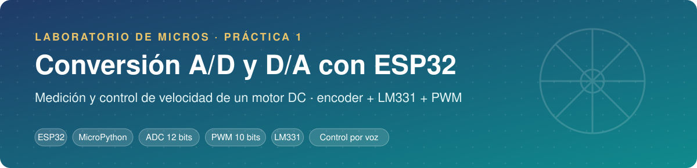
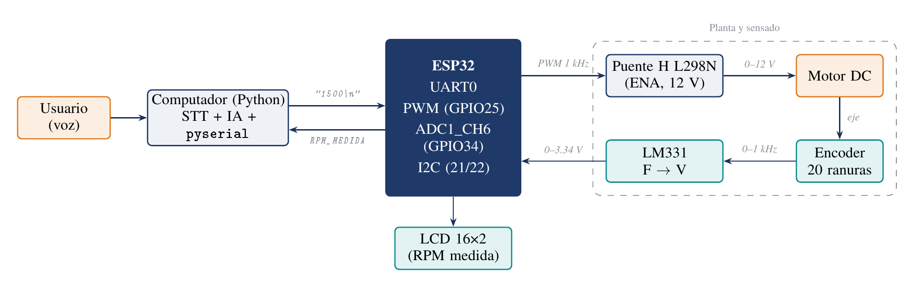
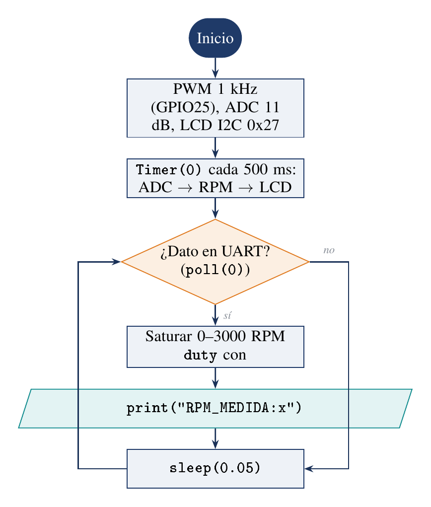
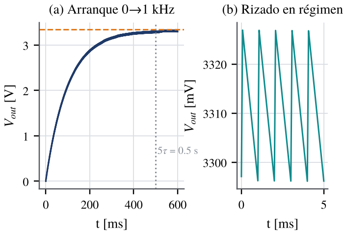
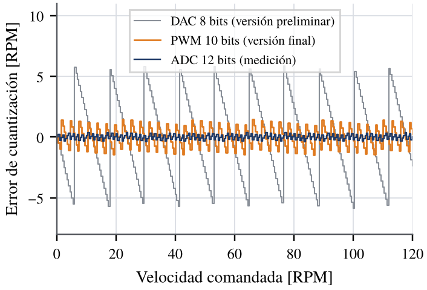

<p align="center"></p>

<p align="center">


</p>

> Sistema con **ESP32** que **mide** la velocidad de un motor DC (encoder → LM331 → ADC), la **muestra** en un LCD 16×2 y la **controla** por **comandos de voz** (Python + IA → UART → PWM → puente H L298N).

## 🎥 Demostración

<p align="center"><a href="https://youtu.be/Z-C1XV2IcGY"></a><br><sub>▶ Clic para ver el video</sub></p>

## 🧩 Arquitectura

<p align="center"></p>

| Mapa conceptual | Programa del ESP32 |
|:-:|:-:|
|  |  |

## 🔌 Hardware

| Elemento | GPIO | Función |
|---|:-:|---|
| Salida LM331 | **34** | ADC1 · 12 bits · atenuación 11 dB |
| L298N (ENA) | **25** | PWM 1 kHz · 10 bits *(v1: DAC 8 bits)* |
| LCD 16×2 (PCF8574 `0x27`) | **21 / 22** | SDA / SCL · I2C 400 kHz |
| Computador | USB | UART0 · 115 200 bps |

<p align="center"> <br><sub>Montaje en el laboratorio · Convertidor F/V con LM331 (Proteus)</sub></p>

## 📐 Ecuaciones de diseño

| Etapa | Ecuación | Resultado |
|---|---|---|
| Encoder (20 ranuras) | $f=\dfrac{\text{RPM}\cdot 20}{60}$ | 3000 RPM → **1 kHz** |
| LM331 | $V_{out}=f\cdot 2.09\,\dfrac{R_L}{R_S}R_tC_t$ | **3.344 V** a 1 kHz |
| Monoestable | $t_1=1.1R_tC_t$ | 74.8 µs |
| Rizado / respuesta | $\Delta V\approx\dfrac{1.9}{R_S}\dfrac{t_1}{C_L}$, $\tau=R_LC_L$ | 33 mV · 0.5 s |
| ADC → RPM | $\text{RPM}=N\cdot 0.723$ | 0.72 RPM/cuenta |
| RPM → PWM | $d=\lfloor \text{RPM}/3000\cdot 1023\rfloor$ | 2.93 RPM/paso |

## 📊 Resultados del análisis

| Transferencia del LM331 | Calibración del firmware |
|:-:|:-:|
|  |  |
| **Rizado y tiempo de respuesta** | **Resolución DAC / PWM / ADC** |
|  |  |

> [!IMPORTANT]
> **Hallazgos:** el ADC satura desde **2960 RPM** (3.344 V > 3.3 V) y es no lineal desde ~2200 RPM → se propone **R<sub>S</sub> = 5.8 kΩ**. La constante del firmware (1000 RPM/V) sobreestima un **11.5 %** frente a la teórica (897 RPM/V). Pasar de DAC (8 bits) a PWM (10 bits) mejoró **4×** la resolución del mando.

## 🗣️ Interfaz por voz

<p align="center"></p>

```text
PC → ESP32 :  "1500\n"             (5 B  → 0.43 ms a 115 200 bps)
ESP32 → PC :  "RPM_MEDIDA:1498\r\n" (17 B → 1.48 ms)
```

## 📁 Estructura

```text
├── firmware/            ← MicroPython (ESP32)
│   ├── main.py          PWM + ADC + LCD + lectura serial no bloqueante
│   └── lib/             lcd_api.py · micropython_i2c_lcd.py
├── pc/                  ← Python en el computador
│   ├── control_voz.py   micrófono → Google STT → DeepSeek → UART
│   └── requirements.txt
├── versiones/v1_dac_wifi/   primera versión: DAC + servidor HTTP por Wi-Fi
└── docs/                informe IEEE (PDF) e imágenes
```

## ▶️ Uso rápido

1. Copiar `firmware/main.py` y la carpeta `lib/` al ESP32 (Thonny) y **cerrar Thonny**.
2. `pip install -r pc/requirements.txt`
3. Poner la API key y el puerto COM en `pc/control_voz.py` y ejecutar: `python pc/control_voz.py`
4. Presionar **ENTER** y decir, por ejemplo, *"pon el motor a mil quinientas revoluciones"*.

## 📄 Informe

📘 [**Informe IEEE completo (PDF)**](docs/Informe_Lab2_Conversion_AD_DA.pdf)

---
<p align="center"><b>Universidad Militar Nueva Granada</b> · Ingeniería en Mecatrónica · Laboratorio de Micros · 2026<br>
Nicolas Santiago Pulido Buitrago · Bryan Andrey Martínez Montaño</p>
