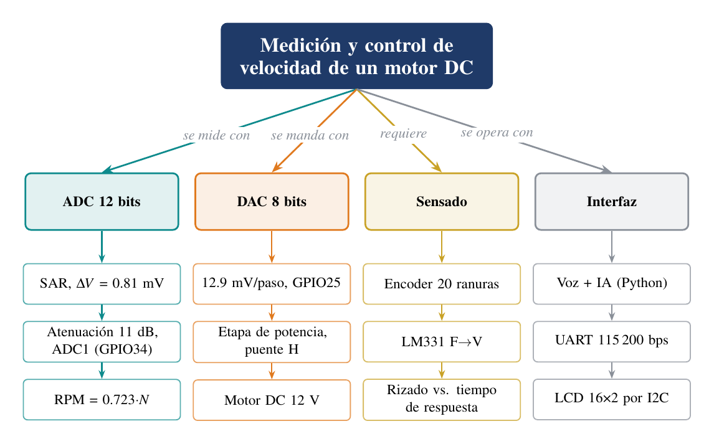
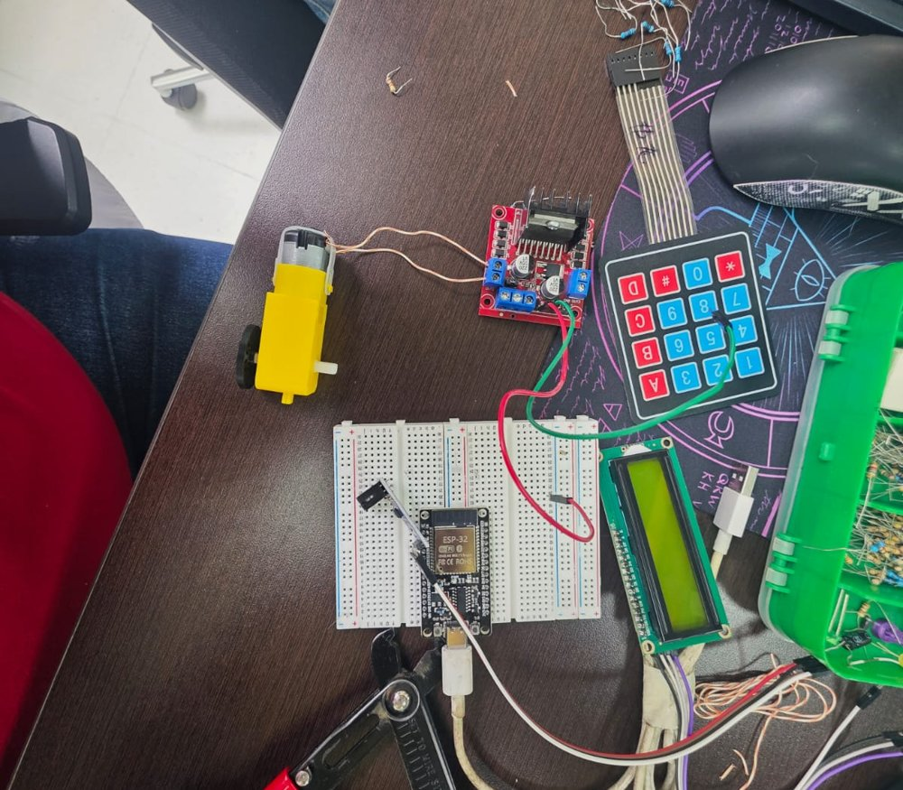
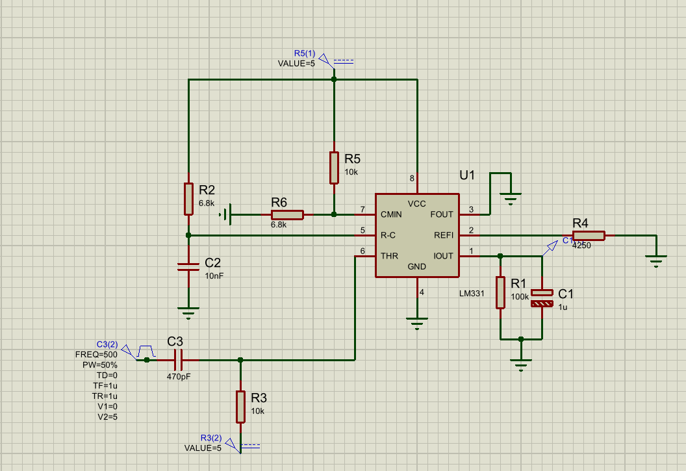
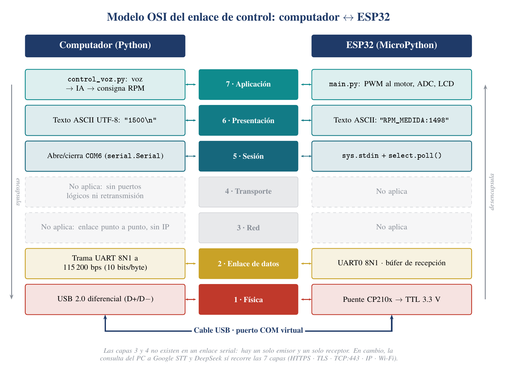
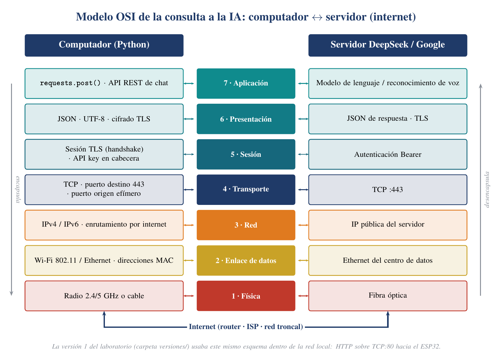
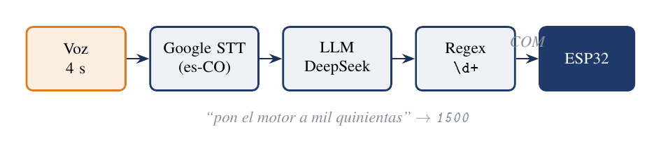
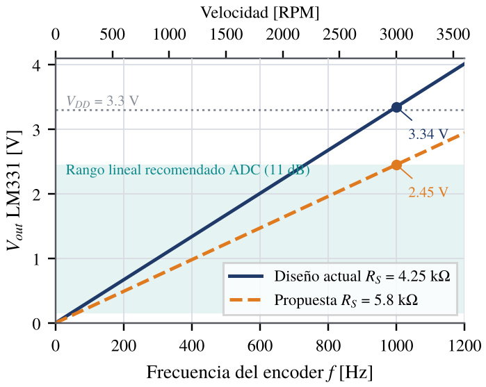
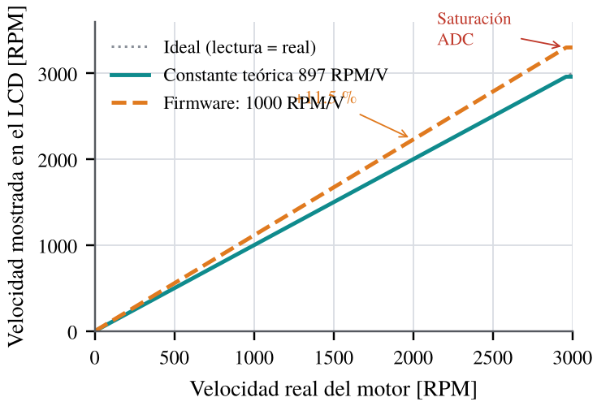
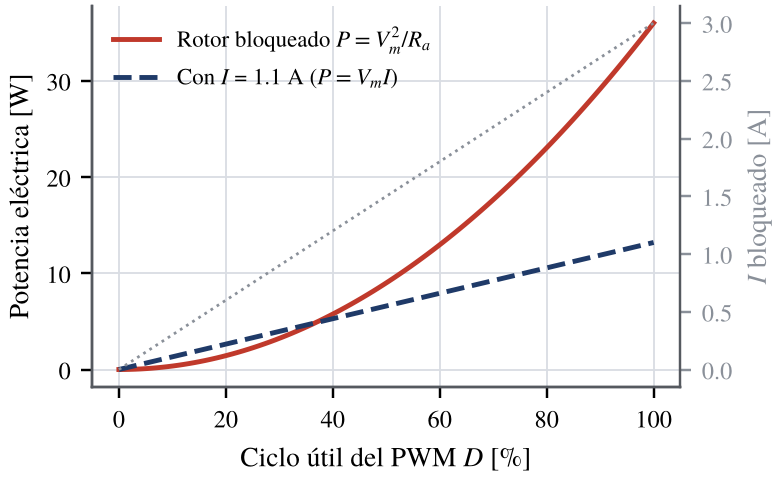

<p align="center"></p>

<p align="center">


</p>

<p align="center"><b>Medir, mostrar y controlar la velocidad de un motor DC con los convertidores del ESP32,<br>usando la voz como interfaz de usuario.</b></p>

---

## 📑 Contenido

1. [Descripción y objetivos](#-1-descripción-y-objetivos)
2. [Demostración](#-2-demostración)
3. [Ficha técnica](#-3-ficha-técnica)
4. [Arquitectura del sistema](#-4-arquitectura-del-sistema)
5. [Hardware y conexiones](#-5-hardware-y-conexiones)
6. [Modelo OSI de las comunicaciones](#-6-modelo-osi-de-las-comunicaciones)
7. [Funcionamiento paso a paso](#%EF%B8%8F-7-funcionamiento-paso-a-paso)
8. [Diseño y ecuaciones](#-8-diseño-y-ecuaciones)
9. [Resultados y análisis](#-9-resultados-y-análisis)
10. [Hallazgos y mejoras](#-10-hallazgos-y-mejoras)
11. [Estructura y uso](#-11-estructura-y-uso)
12. [Informe](#-12-informe)

---

## 🎯 1. Descripción y objetivos

Un motor DC no entrega su velocidad como un número: el **encoder** de 20 ranuras produce pulsos cuya **frecuencia** crece con las RPM. Para que el ESP32 pueda leerla con su **ADC**, un **LM331** convierte esa frecuencia en una tensión continua (0–3.3 V). En el sentido contrario, el ESP32 genera la consigna con una salida analógica —**DAC** en la primera versión y **PWM de 10 bits** en la final— que el **puente H L298N** lleva a los 12 V del motor.

La velocidad deseada se dicta **por voz**: un programa en Python graba al usuario, lo transcribe, le pide a un modelo de lenguaje que extraiga el número de RPM y lo envía por el **puerto serial**. El LCD muestra en todo momento la velocidad objetivo y la medida.

**Objetivos**
- Diseñar el acondicionamiento frecuencia → voltaje para que la velocidad máxima quede dentro del rango del ADC.
- Obtener las ecuaciones de escalamiento ADC → RPM y RPM → salida analógica, y su resolución.
- Implementar una interfaz de usuario (voz + LCD) sin bloquear el microcontrolador.
- Analizar rizado, tiempo de respuesta, potencia y límites del sistema.

## 🎥 2. Demostración

<p align="center"><a href="https://youtu.be/Z-C1XV2IcGY"></a><br><sub>▶ Clic para ver el video en YouTube</sub></p>

## 🧾 3. Ficha técnica

| Parámetro | Valor |
|---|---|
| Microcontrolador | ESP32 (MicroPython) |
| Medición | Encoder 20 ranuras → LM331 → ADC1 12 bits (GPIO34, 11 dB) |
| Actuación | PWM 1 kHz, 10 bits (GPIO25) → L298N → motor 12 V |
| Interfaz | Voz (Google STT + DeepSeek) · LCD 16×2 I2C (0x27) |
| Comunicación | UART 115 200 bps 8N1 por USB (puerto COM) |
| Rango de diseño | 0 – 3000 RPM ↔ 0 – 1 kHz ↔ 0 – 3.34 V |
| Refresco del LCD | 2 Hz (`Timer(0)`, 500 ms) |

## 🧩 4. Arquitectura del sistema

<p align="center"></p>

El sistema es un **lazo**: la consigna viaja *usuario → computador → ESP32 → PWM → puente H → motor* y la medición regresa *motor → encoder → LM331 → ADC → ESP32 → LCD y computador*.

<p align="center"><br><sub>Mapa conceptual de la práctica</sub></p>

## 🔌 5. Hardware y conexiones

| Elemento | GPIO | Función |
|---|:-:|---|
| Salida del LM331 | **34** | ADC1_CH6 · solo entrada · atenuación 11 dB |
| L298N (ENA) | **25** | PWM 1 kHz · 10 bits *(v1: DAC1, 8 bits)* |
| LCD 16×2 + PCF8574 | **21 / 22** | SDA / SCL · I2C 400 kHz · dirección `0x27` |
| Computador | USB | UART0 · 115 200 bps |

<p align="center"> <br><sub>Montaje en el laboratorio · Convertidor F/V con LM331 simulado en Proteus</sub></p>

## 🌐 6. Modelo OSI de las comunicaciones

En esta práctica hay **dos comunicaciones muy distintas**, y el modelo OSI ayuda a ver por qué:

**a) Computador ↔ ESP32 (puerto serial).** Es un enlace **punto a punto**: solo hay un emisor y un receptor, así que no se necesitan direcciones IP (capa 3) ni puertos ni retransmisión (capa 4). El trabajo lo hacen la UART (capa 2) y el texto acordado `"1500\n"` / `"RPM_MEDIDA:x"` (capas 6–7).

<p align="center"></p>

**b) Computador ↔ servidores de IA (internet).** Para convertir la voz en un número, el PC consulta a Google STT y a la API de DeepSeek. Ese tráfico sí recorre **las 7 capas**: JSON cifrado con TLS, TCP al puerto 443 e IP enrutada por internet.

<p align="center"></p>

| Capa | Enlace serial (PC ↔ ESP32) | Consulta a la IA (PC ↔ nube) |
|---|---|---|
| 7 · Aplicación | `control_voz.py` / `main.py` | API REST de chat y STT |
| 6 · Presentación | Texto ASCII | JSON + cifrado TLS |
| 5 · Sesión | Abrir/cerrar `COM6` | Sesión TLS + API key |
| 4 · Transporte | — | TCP :443 |
| 3 · Red | — | IP pública |
| 2 · Enlace | UART 8N1 | Wi-Fi / Ethernet |
| 1 · Física | USB → TTL 3.3 V | Radio / cable / fibra |

## ⚙️ 7. Funcionamiento paso a paso

1. 🎙️ El usuario presiona **ENTER** y habla durante 4 s (*"pon el motor a mil quinientas"*).
2. 🧠 Google STT transcribe el audio y DeepSeek responde **solo el número** (`1500`); *"apaga"* equivale a `0`.
3. 🔌 Python envía `"1500\n"` por el puerto COM (5 B → 0.43 ms).
4. 🔄 El ESP32 revisa el puerto con `select.poll()` **sin bloquearse**, satura el valor entre 0 y 3000 RPM y fija el ciclo útil: `duty = RPM/3000 · 1023`.
5. ⚡ El L298N aplica la tensión media al motor; el encoder genera pulsos y el LM331 los convierte en voltaje.
6. 📟 Cada 500 ms un **temporizador por hardware** lee el ADC, calcula las RPM y actualiza el LCD (`Obj` / `Act`).
7. 📨 El ESP32 responde `"RPM_MEDIDA:x"` y el computador lo muestra en consola.

<p align="center">&nbsp;&nbsp;&nbsp;<br><sub>Programa del ESP32 · Cadena de la interfaz por voz</sub></p>

## 📐 8. Diseño y ecuaciones

| Etapa | Ecuación | Resultado |
|---|---|---|
| Encoder (20 ranuras) | $f=\dfrac{\text{RPM}\cdot 20}{60}$ | 3000 RPM → **1 kHz** |
| LM331 | $V_{out}=f\cdot 2.09\,\dfrac{R_L}{R_S}R_tC_t$ | **3.344 V** a 1 kHz |
| Monoestable | $t_1=1.1R_tC_t$ | 74.8 µs < 1 ms ✔ |
| Rizado / respuesta | $\Delta V\approx\dfrac{1.9}{R_S}\dfrac{t_1}{C_L}$ · $\tau=R_LC_L$ | 33 mV · 0.5 s |
| ADC → RPM | $\text{RPM}=N\cdot\dfrac{3.3}{4095}\cdot\dfrac{60}{20\,K}$ | 0.72 RPM/cuenta |
| RPM → PWM | $d=\lfloor \text{RPM}/3000\cdot 1023\rfloor$ | 2.93 RPM/paso |
| Potencia | $P=V_m I$ · $P_{bloq}=V_m^2/R_a$ | 13.2 W · pico 36 W |

Valores del LM331: $R_t$ = 6.8 kΩ · $C_t$ = 10 nF · $R_L$ = 100 kΩ · $C_L$ = 1 µF · $R_S$ = 4.25 kΩ.

## 📊 9. Resultados y análisis

| Transferencia del LM331 | Calibración del firmware |
|:-:|:-:|
|  |  |
| La salida llega a 3.344 V: el ADC **satura desde 2960 RPM** y es no lineal desde ~2200 RPM. | La constante del código (1000 RPM/V) lee un **11.5 %** más que la teórica (897 RPM/V). |
| **Rizado y tiempo de respuesta** | **Resolución DAC / PWM / ADC** |
|  |  |
| 31 mV de rizado y 0.5 s para estabilizarse: conviene promediar lecturas. | El PWM de 10 bits es **4× más fino** que el DAC; el ADC casi no aporta error. |

<p align="center"><br><sub>Potencia en función del ciclo útil: el puente H debe soportar el pico de arranque (3 A)</sub></p>

## 💡 10. Hallazgos y mejoras

| Observación | Propuesta |
|---|---|
| El ADC satura cerca de 3000 RPM | Cambiar $R_S$ a **5.8 kΩ** (5.6 kΩ + pot. 500 Ω) → 2.45 V a 3000 RPM |
| Constante de calibración 11.5 % alta | Ajustarla con el tacómetro o usar 897 RPM/V |
| El DAC en el pin ENA solo actuaba como ON/OFF | Usar PWM (versión final) o una etapa lineal con transistor |
| Lazo abierto: con carga la velocidad cae | Controlador PI usando la lectura del ADC |
| La voz tarda varios segundos y depende de internet | Recuperar el teclado 4×4 como interfaz alterna |

## 📁 11. Estructura y uso

```text
├── firmware/                ← MicroPython (ESP32)
│   ├── main.py              PWM + ADC + LCD + lectura serial no bloqueante
│   └── lib/                 lcd_api.py · micropython_i2c_lcd.py
├── pc/                      ← Python en el computador
│   ├── control_voz.py       micrófono → Google STT → DeepSeek → UART
│   └── requirements.txt
├── versiones/v1_dac_wifi/   primera versión: DAC + servidor HTTP por Wi-Fi
└── docs/                    informe IEEE (PDF) e imágenes
```

1. Copiar `firmware/main.py` y la carpeta `lib/` al ESP32 con Thonny y **cerrar Thonny** (libera el puerto COM).
2. Instalar dependencias: `pip install -r pc/requirements.txt`
3. Poner la API key y el puerto COM en `pc/control_voz.py` y ejecutar `python pc/control_voz.py`.
4. Presionar **ENTER** y decir la velocidad deseada.

## 📄 12. Informe

📘 [**Informe IEEE completo (PDF)**](docs/Informe_Lab1_Conversion_AD_DA.pdf) — marco teórico, diseño, tablas, gráficas y conclusiones.

---
<p align="center"><b>Universidad Militar Nueva Granada</b> · Ingeniería en Mecatrónica · Laboratorio de Micros · 2026<br>
Nicolas Santiago Pulido Buitrago (7004630) · Bryan Andrey Martínez Montaño (7004588)</p>
